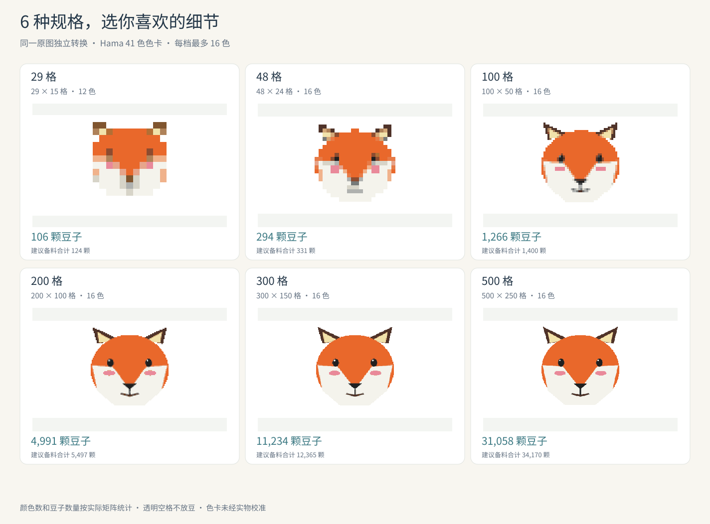

# 免费拼豆｜一张图片，生成六种规格拼豆图纸

**作者：李熙萌 · 当前版本：1.1.2**

[](https://github.com/xili70197-cmyk/bead-pattern/actions/workflows/test.yml)

把 PNG、JPEG、WebP 图片转换成可制作的拼豆图纸。一次生成六档规格，让用户比较细节、用豆量和制作规模，再自行选择。支持 Agent Skill 和独立命令行两种用法。

**One image, six Hama bead pattern sizes. Includes color-coded charts, printable A4 PDFs, exact bead counts and reusable project files.**



上图由仓库自带的小狐狸测试图片实际转换生成；每档都从原图独立计算。

[查看 29 格色号图纸](examples/fox-29-chart.png) · [查看用豆清单](examples/fox-29-counts.csv) · [下载六档示例图纸 ZIP](https://github.com/xili70197-cmyk/bead-pattern/releases/download/v1.1.2/example-fox-six-sizes.zip)

## 六种规格

| 档位 | 长边格数 |
|---|---:|
| 小型 | 29 |
| 中型 | 48 |
| 大型 | 100 |
| 加大型 | 200 |
| 超大型 | 300 |
| 特大型 | 500 |

保持原图比例，短边四舍五入且最低 4 格；极端长宽比通过透明空格补足。默认采用 Hama Midi 41 色色卡，每档最多 16 色。

## 每档交付什么

- **色号图纸 PNG**：每格标注 Hama 色号，附行列坐标、每十格加粗线及完整用豆统计，每格 24 像素。
- **A4 分页 PDF**：每页最多 32×32 格，使用全局坐标，末尾附完整统计。
- **用豆清单 CSV**：色号、色名、精确数量，以及每色增加 10% 并向上取整的建议备料数。
- **工程 JSON**：保存格子矩阵、色卡和参数，兼容原网站 v1 工程，可重新导出。
- **预览 PNG**：便于先查看效果。

批次目录还提供六档对比总览、统计汇总和全部图纸 ZIP。逐档完成后即可先查看和下载，某档失败时保留已经完成的结果。

## 用 Agent 安装

将下面这段话发给支持自定义 Skills 和本地脚本执行的 Agent：

```text
请从 https://github.com/xili70197-cmyk/bead-pattern 安装 bead-pattern 技能。
先检查 Node.js 和固定依赖，再用我上传的图片生成 29、48、100、200、300、500 格六档拼豆图纸。
每完成一档就告诉我，并展示预览和图纸下载链接；最后给我六档对比总览和全部图纸 ZIP。
```

也可以从 [Releases](https://github.com/xili70197-cmyk/bead-pattern/releases/latest) 下载：

| 下载包 | 用途 |
|---|---|
| `bead-pattern-1.1.2-generic.zip` | 通用技能包；解压得到完整 `bead-pattern` 文件夹，放入宿主技能目录 |
| `bead-pattern-1.1.2-workbuddy.zip` | WorkBuddy 市场格式包；按宿主技能导入入口使用 |
| `bead-pattern-1.1.2-skillhub.zip` | SkillHub 上传格式包；ZIP 根目录为 `SKILL.md`，使用平台允许的文件类型 |

仓库根目录同样包含完整 `SKILL.md`、脚本和资源，可整体克隆到 Agent 的技能目录。安装后运行环境检查；具体宿主的技能入口与脚本权限以实际版本为准。目前已经验证的是 Windows 本地运行和安装包解压运行，尚未逐一验证所有 Agent 客户端。

## 独立运行

需要 **Node.js 20.9 或更新版本**，并使用附带 npm 的 Node.js。首次安装依赖需要网络；准备完成后转换与导出离线运行。依赖安装到用户级技能缓存，不需要全局 npm 安装。

```bash
git clone https://github.com/xili70197-cmyk/bead-pattern.git
cd bead-pattern
node scripts/bead.cjs setup
node scripts/bead.cjs doctor
node scripts/bead.cjs generate --input "/path/photo.png" --out "/path/new-result"
```

Windows 示例：

```powershell
node scripts/bead.cjs generate --input "C:\图片\照片.jpg" --out "C:\作品\新的六档图纸"
```

输出目录必须为空，并位于技能安装目录之外。也可直接使用仓库示例：

```bash
node scripts/bead.cjs generate --input "examples/fox-input.png" --out "../bead-example-result"
```

只生成某档、改变颜色数量，或重新导出工程：

```bash
node scripts/bead.cjs generate --input "/path/photo.png" --sizes 100 --max-colors 16 --out "/path/new-100-grid"
node scripts/bead.cjs render --pattern "/path/100-100x50.bead.json" --out "/path/new-render"
```

## 等待时能看到什么

Agent 默认使用后台任务和进度查询，完成一档就展示一档：

```bash
node scripts/bead.cjs start --input "/path/photo.png" --out "/path/new-result"
node scripts/bead.cjs status --out "/path/new-result" --after 0 --wait-ms 5000
```

每次查询更新返回的 `cursor`；`variant-complete` 表示该档全部文件已经可用。状态为 `complete` 时六档及总览、ZIP 均已完成；`partial` 或 `failed` 时查看返回错误及已完成文件。再次查询时用最新 cursor，避免重复通知。停止任务用 `cancel --out`。

## 算法原理

1. **方向校正与 sRGB 标准化**：读取手机照片方向信息，统一工作色彩空间。
2. **Lanczos3 重采样**：每个尺寸从原图独立缩放，计算格子对应颜色；预览使用最近邻放大。
3. **Alpha 阈值判断**：透明度小于 100 的格子为空格；不透明白色正常计为白色豆子。
4. **CIELAB 色彩空间转换**：通过线性 RGB、XYZ 转换到更适合感知色差计算的 Lab 空间。
5. **CIEDE2000（ΔE00）色差计算与最近色搜索**：遍历全部 41 个色卡颜色，选取色差最小的豆色。
6. **颜色频次统计与 Top-K 限色**：默认保留首次匹配中用量最高的 16 色，再用采样颜色重新匹配选定色卡。
7. **逐格精确计数**：PNG、PDF、CSV 和 JSON 共用一个矩阵，每色建议备料为 `ceil(数量 × 1.1)`。

限色采用频次选择，并非 K-means 聚类；小规格也可能丢失文字、眼睛或细线等细节，因此完整保留六档供用户比较。

## 默认设置与边界

- 保留图片背景，不自动抠图。亮度、对比度、饱和度保持中性，锐化为 0；不启用抖动或去噪。
- 支持静态 PNG、JPEG、WebP；输入文件最大 50 MB，解码图像最大 4000 万像素。
- 色卡未经实物校准；PDF 为制作参考图纸，不是实物 1:1 底板。
- 首版专注图片转图纸，不调用 AI 生图，不上传用户图片，不包含可视编辑器。

## 开发与验证

```bash
node scripts/bead.cjs setup
npm test
```

测试包含色差参考值、六档独立转换、透明与白色、手机方向、中文路径、500 格导出、工程重导、逐档进度和错误恢复。详见 [测试说明](docs/TESTING.md)、[命令与工程](references/interface.md)、[运行与接入](references/runtime.md)、[进度与等待](references/progress.md)。

程序使用固定版本的 `sharp 0.34.5`、`pdf-lib 1.17.1`、`fflate 0.8.2`，传递依赖版本与完整性校验保存在锁文件中。

## 作者与资源许可

作者：**李熙萌**。可下载本项目并在本地运行，生成自己的拼豆图纸。

字形资源与色卡附带的必要授权声明分别保留在 `assets/labels/OFL.txt` 和 `assets/palettes/LICENSE`，不作为产品推广内容。公开仓库未额外指定整个项目的商业再分发授权。

遇到问题可在本仓库提交 Issue，附运行环境、命令和错误信息；请先去掉私人路径或不适合公开的图片。
